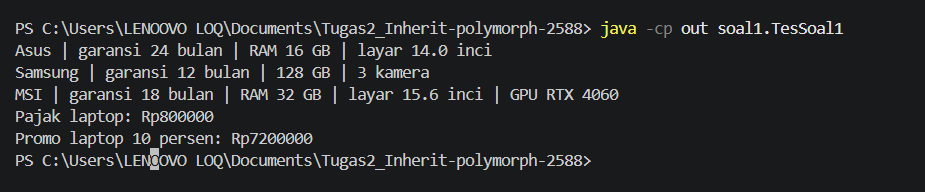
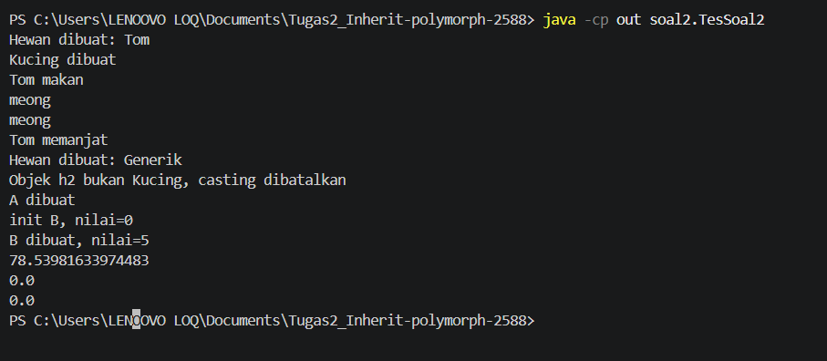
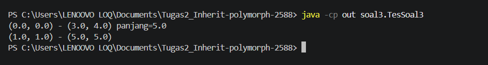
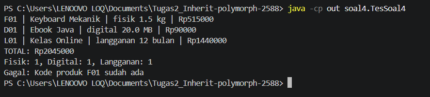

# Tugas 2 Praktikum Pemrograman Berorientasi Objek

**Nama:** Shifa Azzuhra  
**NPM:** 250810701100088  
**Kelas Praktikum:** A  
**Bahasa Pemrograman:** Java

**Repository GitHub:**  
https://github.com/shifaazzuhra/Tugas2_Inherit-polymorph-2588

## Deskripsi Program

Tugas 2 Praktikum Pemrograman Berorientasi Objek terdiri dari empat soal yang membahas inheritance, composition, dan polymorphism menggunakan Java. Setiap soal dibuat dalam package terpisah dan memiliki class pengujian untuk memastikan program berjalan sesuai ketentuan.

## Fitur Program

1. **Soal 1 - Perangkat Elektronik:** Menampilkan informasi laptop, ponsel, dan laptop gaming, menghitung pajak, serta harga setelah diskon.
2. **Soal 2 - Polimorfisme:** Menguji overriding, urutan constructor, upcasting, downcasting, serta perbedaan error kompilasi dan runtime.
3. **Soal 3 - Titik dan Garis:** Menghitung jarak antartitik dan panjang garis serta menerapkan defensive copy.
4. **Soal 4 - Toko Digital:** Menambahkan produk ke keranjang, menghitung total belanja, mencetak struk, menghitung jumlah produk berdasarkan jenis, dan menangani kode produk duplikat.

## Konsep OOP yang Diterapkan

| Konsep | Penerapan | Penjelasan |
|---|---|---|
| Inheritance | Laptop extends Perangkat | Laptop mewarisi atribut dan method dari Perangkat. |
| Multilevel Inheritance | LaptopGaming extends Laptop | LaptopGaming mewarisi fitur Laptop dan Perangkat. |
| Encapsulation | Atribut private dan getter | Membatasi akses langsung ke atribut tertentu. |
| Protected | Atribut harga | Memungkinkan subclass mengakses atribut harga. |
| Constructor | Perangkat, Laptop, Produk, dan lainnya | Menginisialisasi objek saat dibuat. |
| Overriding | Kucing.suara() | Mengubah perilaku method yang diwarisi. |
| Overloading | Constructor Garis | Menyediakan constructor dengan parameter berbeda. |
| Polymorphism | Keranjang.hitungTotal() | Menjalankan perhitungan sesuai jenis objek produk. |
| Composition | Garis dan Keranjang | Garis memiliki objek Titik dan Keranjang menyimpan Produk. |
| Upcasting | Hewan h = new Kucing("Tom") | Menyimpan objek subclass dalam variabel superclass. |
| Downcasting | Kucing k = (Kucing) h | Mengakses kemampuan khusus subclass. |
| Instanceof | TesSoal2 dan Keranjang | Memeriksa jenis objek sebelum casting. |
| Defensive Copy | Garis | Membuat salinan Titik agar data tidak berubah dari luar. |
| Exception Handling | Produk dan Keranjang | Menangani data tidak valid serta kode produk duplikat. |

## Struktur Project

```text
Tugas2_Inherit-polymorph-2588/
├── src/
│   ├── soal1/
│   │   ├── Perangkat.java
│   │   ├── Laptop.java
│   │   ├── Ponsel.java
│   │   ├── LaptopGaming.java
│   │   └── TesSoal1.java
│   ├── soal2/
│   │   ├── Hewan.java
│   │   ├── Kucing.java
│   │   ├── A.java
│   │   ├── B.java
│   │   ├── Lingkaran.java
│   │   ├── Titik.java
│   │   └── TesSoal2.java
│   ├── soal3/
│   │   ├── Titik.java
│   │   ├── Garis.java
│   │   └── TesSoal3.java
│   └── soal4/
│       ├── Produk.java
│       ├── ProdukFisik.java
│       ├── ProdukDigital.java
│       ├── Langganan.java
│       ├── Keranjang.java
│       └── TesSoal4.java
├── .gitignore
└── README.md
```

## Prasyarat

Program dibuat menggunakan Java JDK 25 dan VS Code. Program juga dapat dijalankan menggunakan IntelliJ IDEA atau melalui terminal selama JDK sudah terpasang.

Untuk memeriksa instalasi Java, jalankan:

```powershell
java -version
javac -version
```

## Cara Menjalankan Program

### Menggunakan Terminal VS Code

Buka folder utama project di VS Code, kemudian buka terminal.

Jalankan perintah berikut untuk masing-masing soal.

**Soal 1**

```powershell
javac -d out src/soal1/*.java
java -cp out soal1.TesSoal1
```

**Soal 2**

```powershell
javac -d out src/soal2/*.java
java -cp out soal2.TesSoal2
```

**Soal 3**

```powershell
javac -d out src/soal3/*.java
java -cp out soal3.TesSoal3
```

**Soal 4**

```powershell
javac -d out src/soal4/*.java
java -cp out soal4.TesSoal4
```

### Menggunakan IntelliJ IDEA

1. Buka IntelliJ IDEA dan pilih Open.
2. Pilih folder project `Tugas2_Inherit-polymorph-2588`.
3. Pastikan Project SDK menggunakan JDK yang sudah terpasang.
4. Tandai folder `src` sebagai Sources Root jika belum terdeteksi.
5. Buka class pengujian yang ingin dijalankan, misalnya `TesSoal1.java`.
6. Jalankan method `main()` melalui ikon Run, atau buat Run Configuration dengan main class `soal1.TesSoal1`.
7. Untuk soal lainnya, gunakan main class `soal2.TesSoal2`, `soal3.TesSoal3`, atau `soal4.TesSoal4`.

## Soal 1 - Hierarki Perangkat Elektronik

Program ini menerapkan inheritance melalui class Perangkat, Laptop, Ponsel, dan LaptopGaming.

### Hasil Pengujian

```text
Asus | garansi 24 bulan | RAM 16 GB | layar 14.0 inci
Samsung | garansi 12 bulan | 128 GB | 3 kamera
MSI | garansi 18 bulan | RAM 32 GB | layar 15.6 inci | GPU RTX 4060
Pajak laptop: Rp800000
Promo laptop 10 persen: Rp7200000
```

### Pengujian Hak Akses

Ketika atribut `harga` pada class Perangkat diubah dari `protected` menjadi `private`, muncul error saat kompilasi:

```text
src\soal1\Laptop.java:33: error: harga has private access in Perangkat
        return harga - (harga * diskonPersen / 100);
               ^
src\soal1\Laptop.java:33: error: harga has private access in Perangkat
        return harga - (harga * diskonPersen / 100);
                        ^
2 errors
```

Error terjadi karena atribut private tidak bisa diakses langsung oleh subclass. Sementara itu, method `hitungHargaPromo()` dalam class Laptop menggunakan atribut harga secara langsung.

Setelah harga dikembalikan menjadi protected, program berhasil dikompilasi dan dijalankan kembali.

## Soal 2 - Analisis Output dan Polimorfisme

### Bagian A - Prediksi Output

Sebelum menjalankan program, saya memprediksi bahwa constructor Hewan akan dipanggil sebelum constructor Kucing.

Awalnya saya memperkirakan method `makan()` akan memanggil `suara()` milik Hewan, kemudian `suara()` berikutnya milik Kucing.

Saya juga memperkirakan casting objek Hewan ke Kucing dapat dilakukan dan menampilkan "Generik memanjat".

### Bagian A - Hasil dan Analisis

Hasil program sebelum perbaikan:

```text
Hewan dibuat: Tom
Kucing dibuat
Tom makan
meong
meong
Tom memanjat
Hewan dibuat: Generik
```

Setelah baris terakhir, program mengalami `ClassCastException`.

Saat program dijalankan, constructor Hewan dipanggil sebelum constructor Kucing. Method `makan()` mencetak "Tom makan", kemudian memanggil `suara()` milik Kucing sehingga muncul "meong" dua kali.

Pemanggilan `h.panjat()` menghasilkan error `cannot find symbol` saat kompilasi karena tipe statis h adalah Hewan, sedangkan method `panjat()` hanya dimiliki Kucing.

Pesan error yang diperoleh:

```text
src\soal2\TesSoal2.java:18: error: cannot find symbol
        h.panjat();
         ^
  symbol:   method panjat()
  location: variable h of type Hewan
1 error
```

`ClassCastException` terjadi pada baris `Kucing k2 = (Kucing) h2` karena h2 sebenarnya merupakan objek Hewan, bukan Kucing. Masalah ini diperbaiki menggunakan `instanceof` untuk memeriksa jenis objek sebelum melakukan downcasting.

Pada `h.makan()`, method `suara()` yang dijalankan adalah milik Kucing. Tipe statis h adalah Hewan, tetapi tipe dinamisnya Kucing, sehingga Java menjalankan method yang sudah di-override oleh Kucing.

Setelah perbaikan menggunakan `instanceof`, output menjadi:

```text
Hewan dibuat: Tom
Kucing dibuat
Tom makan
meong
meong
Tom memanjat
Hewan dibuat: Generik
Objek h2 bukan Kucing, casting dibatalkan
```

### Bagian B - Prediksi Output

Sebelum dijalankan, saya memperkirakan output `new B()` adalah:

```text
A dibuat
init B, nilai=5
B dibuat, nilai=5
```

Saya mengira nilai yang muncul adalah 5 karena atribut `nilai` pada class B sudah diisi dengan angka 5.

### Bagian B - Hasil dan Analisis

Hasil program:

```text
A dibuat
init B, nilai=0
B dibuat, nilai=5
```

Prediksi awal saya berbeda dengan hasil program. Awalnya saya mengira nilai sudah berisi 5, ternyata saat `init()` dipanggil dari constructor A, atribut milik B belum diinisialisasi sehingga masih bernilai 0.

Setelah constructor A selesai, nilai baru diinisialisasi menjadi 5. Karena itu, memanggil method yang bisa di-override dari constructor cukup berisiko jika method tersebut menggunakan atribut yang belum siap.

### Bagian C - Lingkaran dan Titik

Hasil program:

```text
78.53981633974483
0.0
0.0
```

Nilai `l3.luas()` menghasilkan 0.0 karena objek yang dibuat sebenarnya adalah Titik, walaupun tipe variabelnya Lingkaran. Java menjalankan method `luas()` milik Titik karena method tersebut sudah di-override.

Menurut saya, hubungan Titik sebagai turunan Lingkaran kurang tepat jika dilihat dari relasi *is-a*, karena titik bukanlah sebuah lingkaran. Jika ada method yang menganggap semua Lingkaran memiliki luas lebih dari nol, penggunaan objek Titik bisa menyebabkan hasil perhitungan tidak sesuai dengan asumsi tersebut.

## Soal 3 - Titik dan Garis

Program ini menggunakan composition karena Garis memiliki dua objek Titik. Program juga menerapkan constructor overloading dan defensive copy.

### Prediksi Output

Sebelum menjalankan program, saya memprediksi output baris kedua adalah:

```text
(100.0, 1.0) - (5.0, 5.0)
```

Saya memperkirakan titik awal garis ikut berubah karena objek Garis menggunakan referensi Titik yang sama dengan variabel t.

### Hasil Pengujian dan Analisis

Hasil perhitungan panjang garis:

```text
(0.0, 0.0) - (3.0, 4.0) panjang=5.0
```

Sebelum menggunakan defensive copy, output baris kedua adalah:

```text
(100.0, 1.0) - (5.0, 5.0)
```

Hasil ini sesuai dengan prediksi saya. Titik awal berubah karena objek Garis dan variabel t menggunakan referensi objek Titik yang sama. Kondisi ini disebut aliasing.

Setelah constructor Garis diperbaiki menggunakan defensive copy, output berubah menjadi:

```text
(1.0, 1.0) - (5.0, 5.0)
```

Perubahan pada variabel t sekarang tidak memengaruhi titik awal Garis karena objek Titik sudah disalin.

### Perbandingan Sebelum dan Sesudah Perbaikan

Sebelum defensive copy lebih cocok digunakan ketika perubahan titik memang ingin langsung memengaruhi garis, misalnya pada aplikasi menggambar yang interaktif.

Setelah defensive copy lebih cocok ketika data garis harus tetap konsisten meskipun objek titik dari luar berubah.

### Inheritance dan Composition

Jika Garis menggunakan `extends Titik`, hubungan antarclass menjadi kurang tepat karena Garis bukan merupakan sebuah Titik. Garis justru memiliki dua titik, yaitu titik awal dan titik akhir.

Karena itu, composition dengan relasi *has-a* lebih sesuai daripada inheritance dengan relasi *is-a*.

## Soal 4 - Mini Project Toko Digital

Program ini membuat sistem keranjang belanja sederhana yang terdiri dari produk fisik, produk digital, dan langganan. Setiap jenis produk memiliki aturan perhitungan harga yang berbeda.

### Hasil Pengujian

```text
F01 | Keyboard Mekanik | fisik 1.5 kg | Rp515000
D01 | Ebook Java | digital 20.0 MB | Rp90000
L01 | Kelas Online | langganan 12 bulan | Rp1440000
TOTAL: Rp2045000
Fisik: 1, Digital: 1, Langganan: 1
Gagal: Kode produk F01 sudah ada
```

### Penjelasan Program

Class Produk menjadi superclass yang menyimpan informasi dasar produk, sedangkan ProdukFisik, ProdukDigital, dan Langganan merupakan subclass dengan perhitungan harga masing-masing.

Class Keranjang menggunakan ArrayList untuk menyimpan daftar produk. Method `hitungTotal()` dan `cetakStruk()` menggunakan polymorphism sehingga harga dan deskripsi produk menyesuaikan jenis objeknya tanpa memerlukan `instanceof`.

Sementara itu, `hitungPerJenis()` menggunakan `instanceof` dan downcasting untuk menghitung jumlah setiap jenis produk. Langganan diperiksa terlebih dahulu karena merupakan turunan dari ProdukDigital.

### Error Handling

Program menggunakan `IllegalArgumentException` untuk menolak data tidak valid seperti nama kosong, harga negatif, berat negatif, ukuran file negatif, atau durasi langganan yang tidak sesuai.

Selain itu, `IllegalStateException` digunakan ketika pengguna mencoba menambahkan produk dengan kode yang sudah ada. Exception tersebut ditangani menggunakan `try-catch` sehingga program dapat menampilkan pesan kesalahan tanpa berhenti secara tiba-tiba.

## Analisis Konsep OOP

### 1. Perbedaan Method Overriding dan Overloading

Overriding adalah penulisan ulang method dari superclass di subclass dengan nama dan parameter yang sama. Contohnya method `suara()` pada class Kucing yang menggantikan method `suara()` milik Hewan. Overloading adalah penggunaan nama method atau constructor yang sama dengan parameter berbeda, contohnya dua constructor pada class Garis. Overriding berkaitan dengan inheritance dan runtime polymorphism, sedangkan overloading memungkinkan pemanggilan method atau constructor berdasarkan parameter yang diberikan.

### 2. Kapan Menggunakan Inheritance dan Composition?

Inheritance digunakan ketika suatu class merupakan jenis khusus dari class lainnya atau memiliki hubungan *is-a*. Contohnya Laptop merupakan turunan dari Perangkat. Composition digunakan ketika sebuah class memiliki objek dari class lain atau hubungan *has-a*. Contohnya Garis memiliki dua objek Titik sebagai titik awal dan titik akhir. Pemilihan keduanya disesuaikan dengan hubungan antarobjek yang ingin dibuat.

### 3. Penggunaan Instanceof dan Downcasting pada Soal 4

Method `cetakStruk()` tidak memerlukan `instanceof` karena menggunakan polymorphism untuk memanggil method sesuai jenis objek sebenarnya. Sementara itu, `hitungPerJenis()` menggunakan `instanceof` untuk membedakan dan menghitung jumlah setiap jenis produk. Downcasting tidak selalu aman karena objek superclass belum tentu merupakan objek subclass yang dituju. Karena itu, `instanceof` digunakan sebelum downcasting agar tidak terjadi `ClassCastException`.

## Dokumentasi Pengujian

Pengujian dilakukan menggunakan terminal VS Code pada masing-masing class pengujian. Program diuji menggunakan data yang ditentukan pada soal serta beberapa skenario untuk melihat error yang muncul.

Screenshot hasil pengujian yang perlu dilampirkan:


### Soal 1


### Soal 2


### Soal 3


### Soal 4



## Batasan dan Pengembangan Lanjutan

Program masih berbasis terminal dan menggunakan data yang dimasukkan langsung melalui kode pengujian. Program belum menyediakan antarmuka grafis, input interaktif, maupun penyimpanan data ke database.

Pengembangan selanjutnya dapat dilakukan dengan menambahkan input pengguna, penyimpanan data, dan antarmuka yang lebih mudah digunakan. Khusus pada Soal 4, sistem keranjang juga dapat dikembangkan dengan fitur penghapusan produk, perubahan jumlah pembelian, dan pengelolaan transaksi.